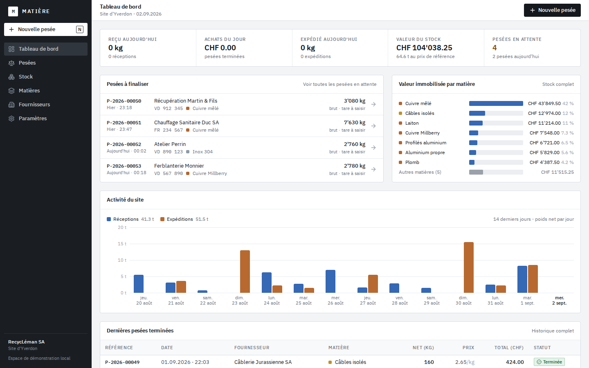
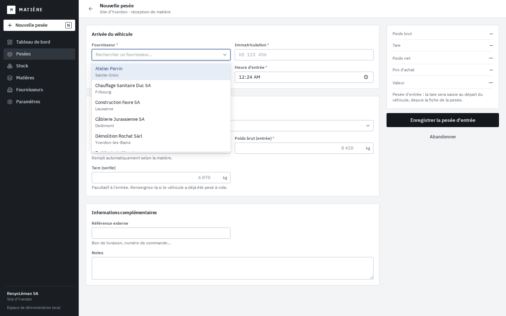
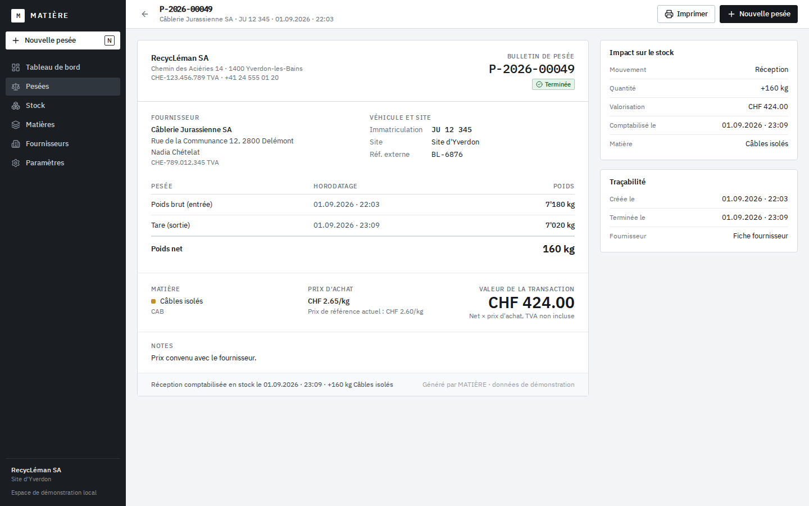

# MATIÈRE

**Operations intelligence for material recovery.**

MATIÈRE is operations software for recycling and scrap-metal yards, hardened for a real
Swiss B2B pilot: authentication, organization membership/roles, PostgreSQL, and audit
logging sit on top of the original weighbridge workflow (still a single demo workspace,
RecycLéman SA, Yverdon-les-Bains, for demo purposes):

vehicle arrival → gross weighing → material reception → tare weighing → net weight →
price calculation → stock update → transaction traceability → operational dashboard.

The interface is in Swiss French; code and documentation are in English. See
`docs/PRODUCTION_READINESS.md` for exactly what is and isn't production-ready today, and
`docs/THREAT_MODEL.md` for the security model.

## Stack

| Layer          | Choice                                                                   |
| -------------- | ------------------------------------------------------------------------ |
| Framework      | Next.js 16 (App Router, Turbopack), React 19, TypeScript strict          |
| Styling        | Tailwind CSS v4 with CSS design tokens, self-hosted IBM Plex Sans / Mono |
| Persistence    | PostgreSQL 16, Drizzle ORM (`pg`) + drizzle-kit migrations               |
| Authentication | Better Auth — email/password, database-backed sessions, scrypt hashing  |
| Validation     | Zod 4 + exact decimal parsing (no floating point for money or weights)   |
| Tests          | Vitest (domain, use cases, authz/tenancy/concurrency), Playwright (e2e) |
| Icons          | lucide-react                                                             |

## Prerequisites

- Node.js **22** or newer (`node --version`)
- npm 10 (bundled with Node)
- Docker (for local PostgreSQL via `docker compose`)
- For end-to-end tests only: `npx playwright install chromium` once

## Local setup

```bash
git clone <this repository> matiere
cd matiere
npm install
docker compose up -d db            # local PostgreSQL on port 55432
cp .env.example .env               # then set a real BETTER_AUTH_SECRET (openssl rand -base64 32)
npm run db:setup                   # migrate + seed the demo workspace
npm run db:create-user -- --email=you@example.com --password="..." --name="Your Name" --role=OWNER
npm run dev                        # http://localhost:3000
```

Sign in with the account you just created — there is no public sign-up (a deliberate choice
for private B2B software; see `docs/DEPLOYMENT.md`).

### Environment variables

All required variables are validated at startup (`src/env/server.ts`) — a missing or
malformed one fails fast, naming the variable but never its value. See `.env.example` for
the full list, local-dev defaults, and format notes.

### Commands

| Command                  | What it does                                                                     |
| ------------------------- | --------------------------------------------------------------------------------- |
| `npm run dev`              | Development server                                                               |
| `npm run build` / `npm start` | Production build / server                                                    |
| `npm run typecheck`        | `tsc --noEmit`                                                                    |
| `npm run lint`              | ESLint (flat config, Next.js + TypeScript rules)                                |
| `npm test`                  | Vitest: domain rules, use cases, database integrity, authz, tenancy, concurrency |
| `npm run test:e2e`          | Playwright, against a dedicated `matiere_e2e` database                          |
| `npm run db:migrate`        | Apply pending migrations from `drizzle/`                                        |
| `npm run db:seed`           | Rebuild the demo dataset (dev/test only — refuses if `NODE_ENV=production`)     |
| `npm run db:create-user`    | Provision a user (see flags above) — the only way to create an account          |
| `npm run db:setup`          | `db:migrate` + `db:seed`                                                        |
| `npm run db:generate`       | Generate a migration after editing `src/db/schema.ts`                           |
| `npm run check`             | typecheck + lint + test + build                                                 |

Next.js allows a single `next dev` per project directory: stop your dev server before
running `npm run test:e2e` (the suite starts its own).

## Product scope (V1)

| Route                                 | Screen                                                                                                                                                                                                                      |
| ------------------------------------- | --------------------------------------------------------------------------------------------------------------------------------------------------------------------------------------------------------------------------- |
| `/`                                   | **Tableau de bord** — today's receipts and purchases, dispatched tonnage, estimated stock value, pending weighings, stock value by material, 14-day activity, recent transactions                                           |
| `/pesees/nouvelle`                    | **Nouvelle pesée** — the hero workflow: supplier (searchable, inline creation), plate with known vehicles, material with reference price, gross, optional tare, live net/value, keyboard-first (`N` opens it from anywhere) |
| `/pesees`                             | **Pesées** — searchable, filterable, sortable, paginated ticket table                                                                                                                                                       |
| `/pesees/[id]`                        | **Bulletin de pesée** — printable transaction record; tare entry and completion for open tickets; cancellation                                                                                                              |
| `/stock`                              | **Stock** — quantity, reference price, estimated value, 7-day movement, last movement per material; recent movements                                                                                                        |
| `/matieres`, `/matieres/[id]`         | **Matières** — material catalogue, purchase price update with history, stock movements, dispatch (shipment) and inventory correction                                                                                        |
| `/fournisseurs`, `/fournisseurs/[id]` | **Fournisseurs** — directory with activity, detail with vehicles and ticket history, creation and edition                                                                                                                   |
| `/parametres`                         | **Paramètres** — company, yard, conventions, demo data reset                                                                                                                                                                |

## Architecture

A modular monolith with explicit layers:

```
UI (src/app, src/components)
  → auth/session (src/server/auth.ts, src/proxy.ts)   Better Auth, redirect-only Proxy gate
  → org context / authorization (src/server/context.ts, src/domain/authorization.ts)
  → server actions (src/server/actions)      parse FormData with Zod, return typed results
  → use cases (src/server/use-cases)         transactions, invariants, per organization, audit
  → domain rules (src/domain)                pure TypeScript, unit-tested
  → persistence (src/db)                     Drizzle schema, migrations, seed
```

Read models live in `src/server/queries` (joins and aggregates, no N+1). Swiss formatting
lives only in `src/lib/format.ts`. `src/server/context.ts`'s `getOrgContext()`/
`requireOrgContext(permission)` resolve the organization and role exclusively from the
authenticated session — never from client input — and are the real enforcement boundary for
every page and Server Action (`src/proxy.ts` only handles the redirect-to-sign-in UX).

### Key domain rules

- **Units**: weights are integer grams, money is integer CHF centimes, unit prices are
  integer centimes per tonne. The `kg` / `t` price unit of a material only changes how a
  price is typed and displayed. No floating point touches money or weights; operator input
  is parsed exactly (`8'420.5`, `6,15`, `185`).
- **Net weight** = gross − tare; the tare can never exceed the gross and the net must be > 0.
- **Value** = net × unit price ÷ 1'000'000, rounded half-up to the centime.
- **Completion** requires supplier, material, plate, gross, tare and price. It books exactly
  one `receipt` inventory movement in the same transaction; stock is the signed sum of
  movements. Completed tickets are immutable.
- **References** (`P-2026-00042`) are allocated from an organization counter inside the
  creation transaction.
- Foreign keys and check constraints are enforced on every write (see `withTransaction`).

### Database

PostgreSQL 16. Schema in `src/db/schema.ts`; SQL migrations in `drizzle/` (the only
supported schema-evolution mechanism — never `drizzle-kit push` against a real database).
Business tables: `organizations`, `organization_memberships`, `yards`, `suppliers`,
`vehicles`, `materials`, `material_prices`, `weighing_tickets`, `inventory_movements`,
`audit_events`. Auth tables (`user`, `session`, `account`, `verification`, `rate_limit`)
mirror Better Auth's own schema. Timestamps are `timestamp with time zone`, rendered in
Europe/Zurich. Concurrency-sensitive writes (ticket completion, stock-affecting movements)
use `SELECT ... FOR UPDATE` row locks — see `src/server/use-cases/concurrency.test.ts`.

## Demo data

`npm run db:setup` (or the reset button in _Paramètres_, OWNER-only and disabled outright
when `NODE_ENV=production`) generates a deterministic,
internally consistent dataset relative to today: 12 materials with **demo prices**
(not market quotations), 12 fictional Swiss-romand suppliers with vehicles, about 60
weighings over three weeks (a few still awaiting their tare, two cancelled), opening
balances and shipments. All figures pass through the domain functions, so tickets,
movements and stock always agree. Every company, person and plate is invented.

## Testing

```bash
npm test          # 98 tests: units, status transitions, inventory, use cases, DB integrity,
                   #           authorization matrix, cross-tenant IDOR suite, transaction
                   #           concurrency (real concurrent double-completion/double-dispatch),
                   #           env validation
npm run test:e2e  # 12 flows: sign-in/out and generic invalid-credentials message, one-pass
                   #           weighing, arrival then tare, invalid values, price update,
                   #           shipment with over-shipping refused, quick supplier +
                   #           cancellation, ticket list filters/search/sort/pagination, N shortcut
```

## Screenshots

Captured from the seeded demo workspace at 1440×900.

| Tableau de bord                                    | Nouvelle pesée                                       | Bulletin de pesée                                  |
| -------------------------------------------------- | ---------------------------------------------------- | -------------------------------------------------- |
|  |  |  |

## Limitations

- One workspace (yard) per organization; one material per weighing ticket (mixed loads need
  several tickets).
- Completed tickets cannot be corrected or cancelled (create a new one).
- Shipments ("expéditions") are recorded per material from the material page; there is no
  customer/sales ticket flow.
- Printing uses the browser's print dialog (print stylesheet); no PDF generation.
- Photos/attachments are not stored.
- No public sign-up, no in-app member invitation/role-change UI, no self-service password
  reset — all three are CLI-provisioned by whoever operates the deployment. See
  `docs/PRODUCTION_READINESS.md` for the full, current PASS/PARTIAL/BLOCKER breakdown before
  relying on this for a real deployment.

## Production hardening

This phase (see `docs/` for the full write-up) added: PostgreSQL, Better Auth
(email/password, database-backed sessions), organization membership with
OWNER/ADMIN/OPERATOR/VIEWER roles enforced server-side on every action, systematic tenant
isolation (verified by a dedicated IDOR test suite), an append-only audit trail, security
headers, a threat model, CI with dependency auditing and CodeQL, and operational docs
(backup/restore, deployment, data protection, production readiness). Nothing here claims
"100% secure" or "fully compliant" — see `docs/PRODUCTION_READINESS.md` for residual risks
and what still needs to happen before onboarding a first real customer.

## Recommended roadmap

1. In-app membership management (invite/role-change/remove) and a read-only audit-log
   viewer — the two most valuable follow-ups to this phase.
2. Multi-line tickets, corrections with reversing movements, PDF receipts with signature.
3. Weighbridge integration (serial/IP scale), plate recognition, supplier statements and
   payments.

## License note on fonts

IBM Plex is distributed under the SIL Open Font License (see `src/app/fonts/LICENSE.txt`).
